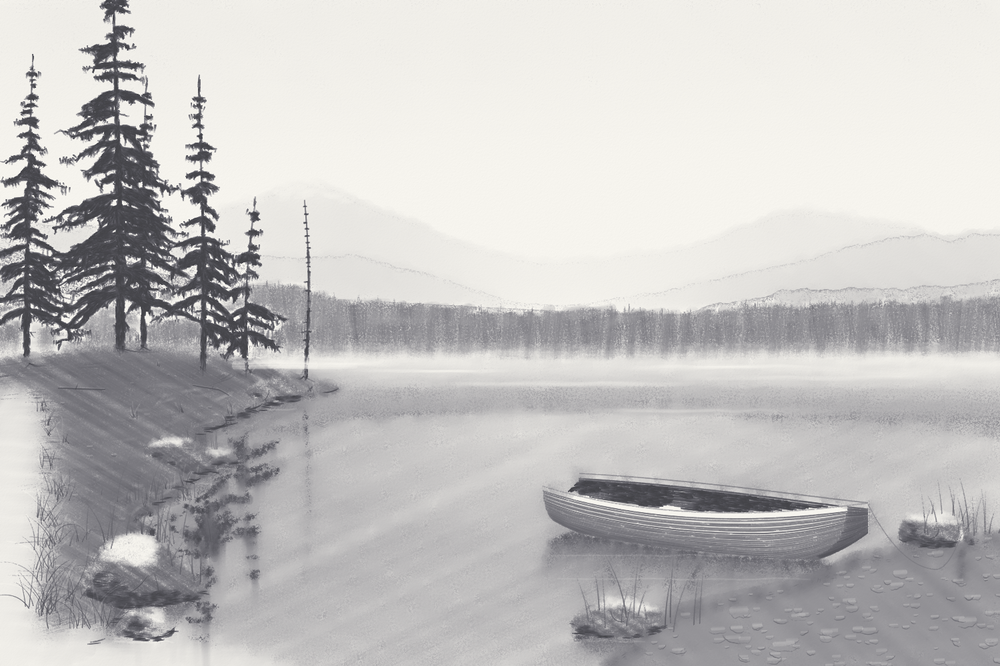
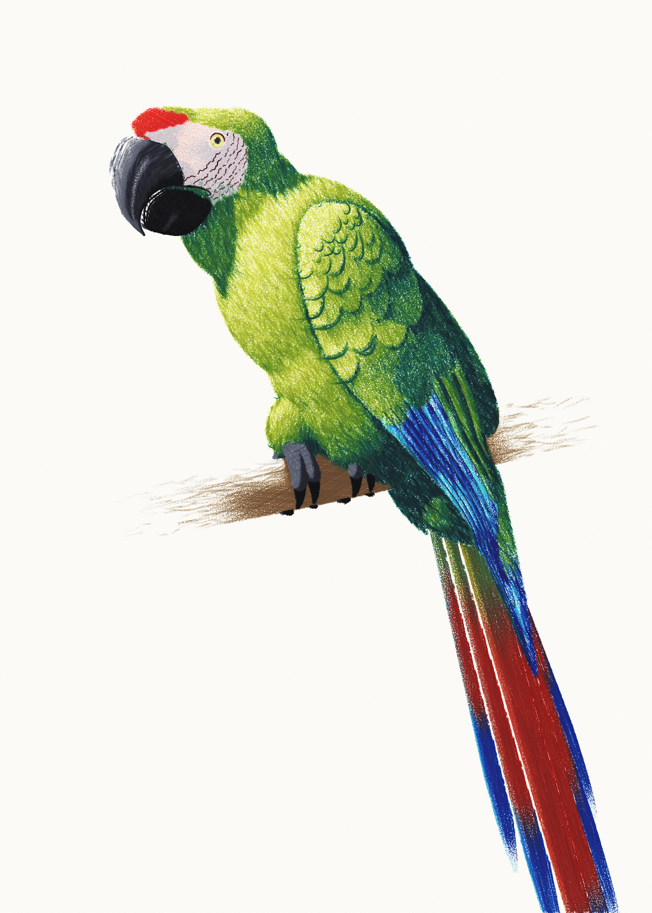
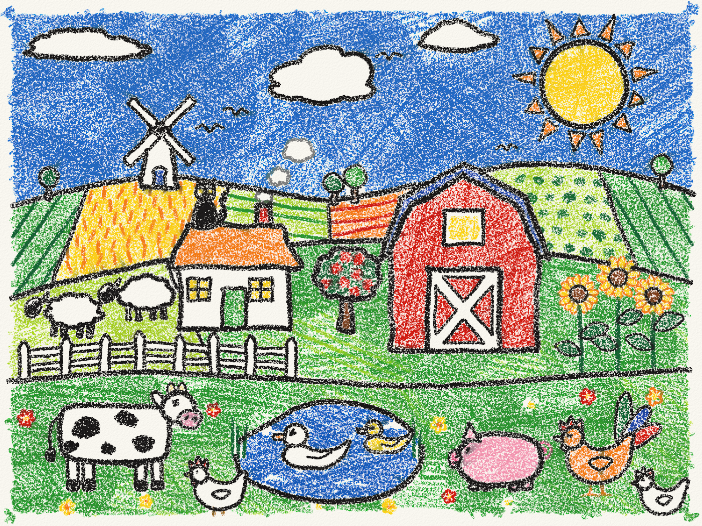
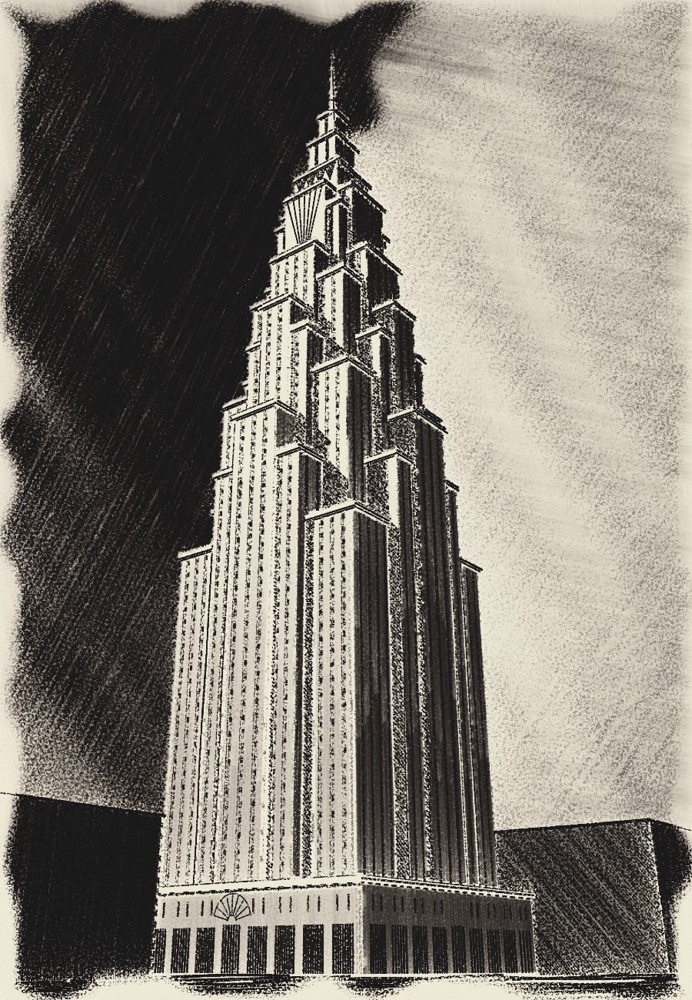
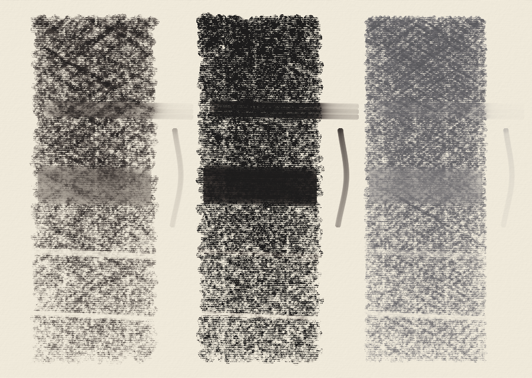
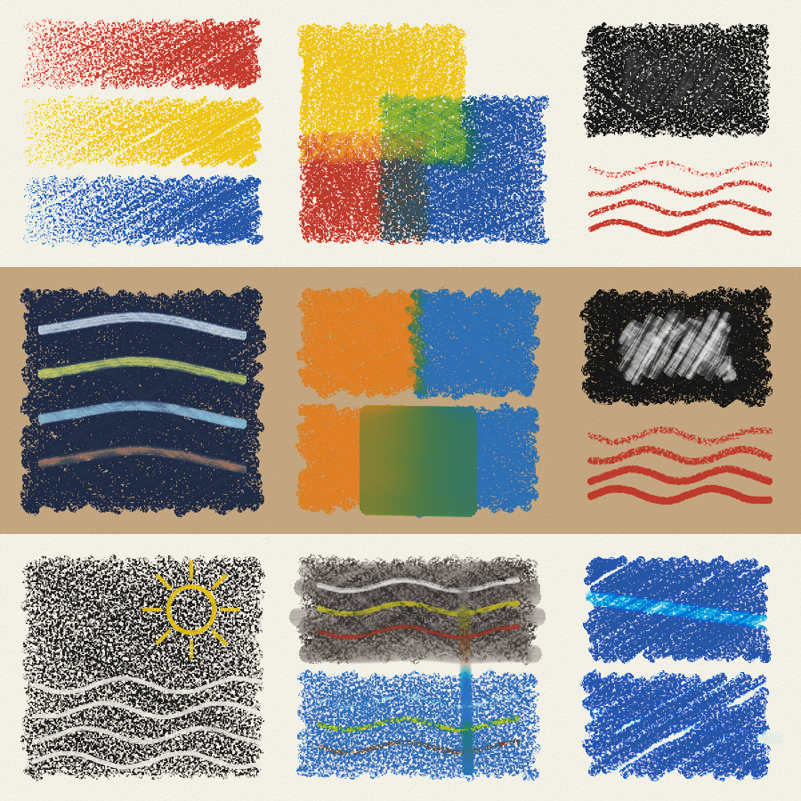

# murex

[](https://github.com/joce/murex/actions/workflows/ci.yml)
[](https://codecov.io/gh/joce/murex)
[](https://github.com/astral-sh/ruff)
[](https://github.com/psf/black)
[](https://github.com/joce/murex/blob/main/LICENSE)

Simulations of artists' media: you describe marks (a path, a tool, a
pressure) and murex works out what the medium does with them. Pencils wear
and crush the tooth of the paper, charcoal leaves dust a stump can drag,
wax resists what goes over it; oil paint is laid, dragged, mixed and lifted
by brushes and knives, and a lamp lights the relief. Colours mix as
pigments do, so blue and yellow give green, not grey.

The murex is the sea snail Tyrian purple was made from: this is where the
media get their colour. Each family of media is a part of it, named after
one of its own:

- [`murex.fusain`](docs/fusain/README.md): dry media on a paper with tooth.
  Graphite and coloured pencils, charcoal, soft, hard and oil pastels,
  pastel pencils, Conté crayons, wax crayons and ballpoint pens; stumps,
  fingers, erasers, a knife, fixative.
- [`murex.huile`](docs/huile/README.md): oil paint on a canvas, a panel or
  glass. Brushes of every shape, painting knives, rags; wet-into-wet mixing,
  glazes over dried layers, impasto lit by a lamp.
- `murex.aquarelle`, to come: wet media (ink, watercolour, markers).

Every picture below is a single script of marks: numpy only decides where
they go.

<table>
<tr>
<th width="50%">Drawn with <code>murex.fusain</code></th>
<th width="50%">Painted with <code>murex.huile</code></th>
</tr>
<tr>
<td></td>
<td></td>
</tr>
<tr>
<td><em>Morning mist on a mountain lake, in graphite.</em></td>
<td><em>A winter village in the manner of Bruegel, thin paint on an oak panel, each layer left to dry.</em></td>
</tr>
<tr>
<td></td>
<td></td>
</tr>
<tr>
<td><em>A great green macaw in coloured pencil, from a solid model of the bird.</em></td>
<td><em>After Rembrandt's</em> Self-Portrait <em>of 1659, painted from a photograph of it, each stroke following the form.</em></td>
</tr>
<tr>
<td></td>
<td></td>
</tr>
<tr>
<td><em>A still life in three ballpoints: the ink bronzes where it is heavy.</em></td>
<td><em>After Seurat's</em> Gray Weather, Grande Jatte<em>: over a hundred thousand dots, stippled.</em></td>
</tr>
<tr>
<td></td>
<td></td>
</tr>
<tr>
<td><em>A farm on a hill in wax crayon, as naive art has it.</em></td>
<td><em>Behind glass, in the manner of Kandinsky's Murnau years: painted in reverse, seen through the front.</em></td>
</tr>
<tr>
<td></td>
<td></td>
</tr>
<tr>
<td><em>Broadway in SoHo on an autumn afternoon, in soft pastel on toned paper.</em></td>
<td><em>After Whistler's</em> Falling Rocket<em>: thin washes of night, and the sparks spattered on.</em></td>
</tr>
<tr>
<td></td>
<td></td>
</tr>
<tr>
<td><em>An imagined art deco tower in charcoal, seen from the street so that it towers.</em></td>
<td><em>After Bob Ross's</em> Towering Peaks<em>, painted step by step the way he paints it on the show.</em></td>
</tr>
<tr>
<td></td>
<td></td>
</tr>
<tr>
<td><em>A pear and an egg</em> aux trois crayons<em>: black, sanguine and white Conté on tan paper.</em></td>
<td></td>
</tr>
</table>

## Installing

Python 3.11 or newer, with numpy and numba. The release on PyPI (0.2.0)
predates the media and holds the colour science and paths only; until the
next release, install from GitHub:

```bash
pip install "murex[pil] @ git+https://github.com/joce/murex"
```

The `pil` extra brings Pillow, which only reference images and
`Canvas.to_pil()` need. The engines are compiled, and the result is cached:
the first stroke of a medium after installing waits for the compiler (about
a minute for huile, a quarter of that for fusain), once per install and per
machine; after that a script starts in under a second. `import murex` alone
loads no medium and compiles nothing.

## Drawing: `murex.fusain`

```python
from murex.fusain import Sheet, charcoal, papers, pencils, tools

sheet = Sheet(600, 400, paper=papers.CARTRIDGE, seed=1)

# A stroke is a path, a medium and a pressure: a 2B line, firmer as it goes.
sheet.stroke(
    [(40, 60), (200, 30), (360, 70), (560, 40)], pencils.B2, lambda u: 0.2 + 0.7 * u
)

# A tone is shaded in strokes, as a hand lays them; a second layer goes across.
sheet.shade((40, 100, 280, 230), pencils.HB, pressure=0.5)
sheet.shade((40, 100, 280, 230), pencils.HB, pressure=0.5, angle=-40)

# Charcoal leaves dust: a stump drags it out, an eraser lifts a light out of it.
sheet.shade((320, 100, 560, 230), charcoal.VINE, pressure=0.6, width=14)
sheet.smudge([(340, 130), (590, 140)], tools.STUMP, pressure=0.7)
sheet.erase([(330, 200), (550, 190)], tools.KNEADED, pressure=0.7)

# Coloured pencils are waxy and translucent: blue over yellow reads green.
sheet.shade((40, 270, 330, 370), pencils.coloured("#f2c40f"), pressure=0.6)
sheet.shade((230, 270, 560, 370), pencils.coloured("#2456a6"), pressure=0.6)

sheet.save("drawing.png")
```


Tone depends on the pressure and on how many layers are laid, as on real
paper, and the tooth of the paper shows through. What the sheet holds is
physical: a hard pencil pressed hard crushes the tooth and a stylus indents
a groove, and what is shaded over either skips it; charcoal and pastel lie
as dust a stump drags and an eraser lifts, until fixative sets it; coloured
pencil and crayon leave a film of wax that a blender burnishes, an eraser
slides on and charcoal will not take over (wax resist); ballpoint ink is a
stain in the paper that only a knife scrapes out.

<table>
<tr>
<td width="50%"></td>
<td width="50%"></td>
</tr>
<tr>
<td><em>Graphite from 4H to 8B, layers, a pencil on its side, hatching; below, lines indented with a stylus and tooth crushed by a hard pencil.</em></td>
<td><em>Vine and compressed charcoal and a 4B, each dragged with a stump, rubbed with a finger, and lifted with a kneaded and a vinyl eraser.</em></td>
</tr>
<tr>
<td></td>
<td></td>
</tr>
<tr>
<td><em>Coloured pencils laid over one another, burnished, scratched with a knife; soft pastels on grey paper, blended with a finger.</em></td>
<td><em>Wax crayons and oil pastels; below, charcoal shaded over lines of crayon, which it skips.</em></td>
</tr>
</table>

The whole of it, medium by medium and tool by tool, is in
[`docs/fusain/README.md`](docs/fusain/README.md); the model behind it in
[`docs/fusain/design.md`](docs/fusain/design.md).

## Painting: `murex.huile`

```python
from murex.huile import Canvas, Paint

canvas = Canvas(600, 400, seed=1)

blue = Paint("#23399b", opacity=0.5)  # a semi-transparent ultramarine
yellow = Paint("#f7c600")  # an opaque cadmium yellow

# A stroke is a spline through your points, a paint and an amount of paint.
canvas.stroke([(60, 140), (250, 100), (540, 170)], paint=blue, amount=12, width=50)

# Crossing it while it is still wet: pressure decides how much they churn together.
canvas.stroke(
    [(200, 30), (230, 200), (190, 370)], paint=yellow, amount=10, width=40, pressure=0.2
)
canvas.stroke(
    [(400, 30), (430, 200), (390, 370)], paint=yellow, amount=10, width=40, pressure=0.9
)

# A stroke with no paint is a clean brush: it drags and blends the wet paint.
canvas.stroke([(80, 300), (560, 300)], width=40, pressure=0.6)

canvas.save("painting.png")
```


Paint has a body and a thickness. A brush holds a load that runs out and
picks up what it crosses; a knife lays a slab whose thickness the pressure
sets; a rag lifts. Wet paint churns into what it crosses, while paint left
to dry (`canvas.dry()`) is glazed over and shows through. Stiff paint holds
the marks of the tool, and the renderer lights them with a lamp of some size:
soft shadows in the grooves, sharp highlights on the wet crests. A
`Reference` image tells a script, at the scale of the brush in hand, what
colour to mix and which way the forms run.

<table>
<tr>
<td width="50%"></td>
<td width="50%"></td>
</tr>
<tr>
<td><em>Calligraphy with a flat, filbert leaves, fan grass, deer-foot stippling, a mop blending, knife slabs, rigger branches.</em></td>
<td><em>A palette knife from a light to a hard pressure, knives of every shape, a comb and a scraper through wet paint.</em></td>
</tr>
<tr>
<td></td>
<td></td>
</tr>
<tr>
<td><em>Impasto: the same colour with more and more paint, an overloaded brush pressed harder, paint thinned and stiffened.</em></td>
<td><em>Transparent glazes over a dried value study, and opaque paints that hide it.</em></td>
</tr>
</table>

Brushes, knives, surfaces, loading a brush with several paints, dabbing and
spatter, and how the engine works are in
[`docs/huile/README.md`](docs/huile/README.md).

## What the media share

Colour is spectral: a colour becomes a smooth reflectance spectrum over 24
bands, and a pigment the Kubelka-Munk absorption and scattering that give
that colour at a normal thickness over white. Mixing adds them by volume, so
mixtures darken and go subtractive as real ones do, and a layer has a
thickness through which what is under it shows.

```python
from murex import Pigment, mix_colors

mix_colors(["#1b3fa0", "#f5d000"])  # '#418340': a green (averaging the RGB gives '#888850', a grey)

blue, white = Pigment("#1b3fa0"), Pigment("#f4f1ea")
Pigment.mix((blue, 1), (white, 3)).hex  # '#75abe0': a tint, not a wash

glaze = Pigment("#8e1b2c", opacity=0.3)  # a transparent crimson
glaze.appearance(thickness=0.25, over="#f2c80f")  # a warm red over yellow (#d43923)
glaze.appearance(thickness=0.25, over="#ffffff")  # a pink over white (#e64382)
```


*In each pair of rows, the top row is mixed as pigments, the bottom one
averaged in RGB.*

The rest of what the media share is there to be used too:

- `murex.spectral`: the conversions between sRGB, spectra and CIELAB, and
  `km_layer`, which works out a batch of Kubelka-Munk layers in compiled
  code, each over one ground or a ground of its own.
- `Bezier`, `CatmullRom`, `Polyline`: stroke paths resampled by arc length,
  and values that vary along a stroke.
- `murex.noise`: textures (paper, weaves, wood grain).
- `Reference`: a reference image, asked for its colour, value, direction and
  detail at the scale of the tool in hand, and for a stroke path that follows
  its forms.
- `write_png` and `murex.filters`: output and small image filters.

```python
from murex import CatmullRom

path = CatmullRom([(10, 10), (60, 40), (120, 20)])
points, tangents, u, knot = path.sample(0.5)  # every half pixel along it
path.length  # in pixels: about 122.8
```

The numbers are checked to the bit: both media test their pictures byte for
byte, so a change that moves a result here is a breaking change, said so in
the [changelog](CHANGELOG.md).

## The examples

Each script under [`examples/fusain/`](examples/fusain) and
[`examples/huile/`](examples/huile) writes its pictures to the `output/`
folder beside it. Run them from the root of the repository:

```bash
python examples/fusain/quickstart.py      # the drawing above
python examples/fusain/lake.py            # the lake: 37,000 strokes, in about three minutes
python examples/huile/quickstart.py       # the painting above
python examples/huile/demo.py             # huile's figures of brushes, knives, surfaces and the rest
python examples/huile/bruegel_winter.py   # the winter village: 21,000 strokes, in about two minutes
```

## What comes next

The media still live apart: a fusain `Sheet` and a huile `Canvas` are
separate states. The aim is the most realistic simulation of any medium, and
of media together, charcoal under oil and coloured pencil over ink; that
needs one surface that every medium reads and writes. It is to be designed
with `murex.aquarelle`, the first medium written for it.

## Development

```bash
git lfs install                # once per machine, before cloning: the images are in Git LFS
uv sync --group dev --frozen   # install the package and the development tools
uv run pytest -n auto          # the tests on every core (the first run compiles the kernels)
uv run pytest tests/fusain     # one medium's tests only
make pre-push                  # lint, types, the tests under coverage, spelling
make tox                       # every Python version and the built wheel, as CI runs them
```

Each medium has its own tools to tell whether a change moved its picture:
`tools/fusain/fingerprint.py` hashes a suite of drawings, and
`tools/huile/bench.py --save DIR` then `--compare DIR` compares sixteen
painted scenes byte for byte. [`AGENTS.md`](AGENTS.md) has the layout of the
package and its conventions.

## License

[MIT](LICENSE)
